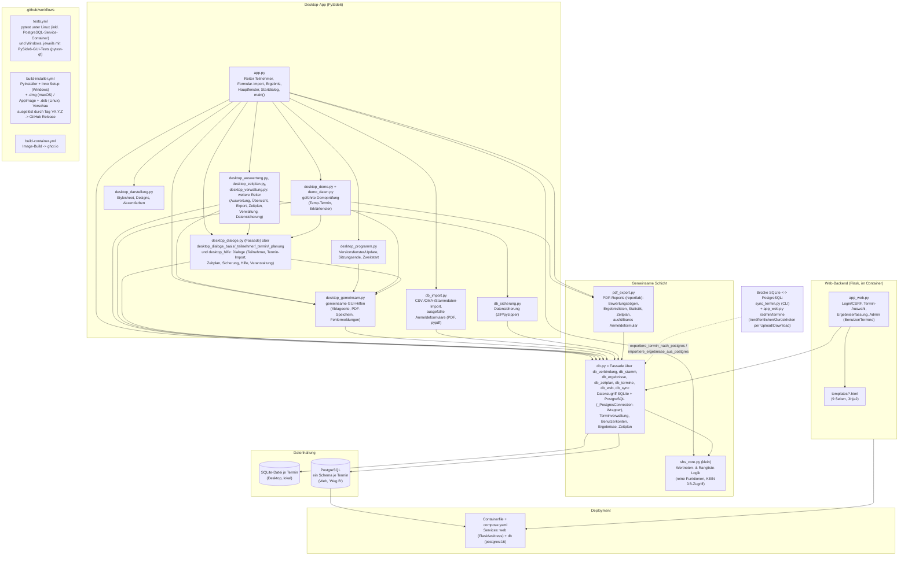

# Architekturüberblick: SHS-Prüfungsprogramm

Stand: 20.09.2026 (Modul-/Testübersicht aktualisiert 22.09.2026, Modulaufteilung 27.09.2026, Anmeldeformular 28.09.2026, UX-Test-Umsetzung 03.10.2026). Ergänzt `Grobkonzept.md` (ursprünglicher Migrationsplan, Stand 10.09.) um den
aktuellen, tatsächlich umgesetzten Stand inkl. der später hinzugekommenen Web/PostgreSQL-Variante.
Gedacht als schneller Einstieg für neue Sitzungen/Subagents, die den Code noch nicht kennen -
Details und Historie einzelner Entscheidungen stehen weiterhin in `Fortschritt.md`.
Die Abläufe (Programmstart, Termin öffnen, Teilnehmer, Zeitplan, Ergebniserfassung,
Auswertung, Web-Erfassung, Datensicherung, Update, Demoprüfung) sowie die Klassen der
Desktop-App zeigt `UML.md` als Mermaid-Diagramme. Offene, zurückgestellte und akzeptierte
Punkte stehen gesammelt in `OFFEN.md`.

## 1. Zwei Laufzeitumgebungen, eine gemeinsame Datenschicht

Das Programm existiert in zwei parallelen Frontends, die auf denselben Fachfunktionen aufsetzen:

- **Desktop-App** (`app.py` + `desktop_*.py`, PySide6) - läuft lokal bei der Prüfungsleitung, eine Person,
  eine SQLite-Datei je Termin (`termine_ordner()`), volle Funktionalität (Termin anlegen,
  Teilnehmer, Ergebnisse, Zeitplan, PDF-Ausgabe, Datensicherung).
- **Web-Backend** (`app_web.py`, Flask) - läuft im Container am Prüfungstag, mehrere Richter
  gleichzeitig, NUR Ergebniserfassung (bewusst eingeschränkter Umfang, siehe Modul-Docstring
  dort). Datenhaltung in PostgreSQL, ein Schema je Termin ("Weg B").

Beide Frontends rufen dieselben Funktionen in `db.py`/`shs_core.py`/`pdf_export.py` auf - die
Fachlogik (Wertnoten, Rangliste, Migrationen) existiert nur EINMAL, nicht getrennt für
SQLite und PostgreSQL.

## 2. Modultabelle

Ein Satz je Modul; Einzelheiten (Funktionen, Sonderfälle, Historie) stehen in `Modulreferenz.md` und im Docstring des Moduls.

| Datei | Zweck | Test |
|---|---|---|
| `app.py` | Desktop-Einstieg: `HauptFenster`, `StartDialog`, `main()` | `test_gui_termin.py` |
| `desktop_teilnehmer.py` | Reiter Teilnehmer (Tabelle, Dialoge, Tauschen, Rückgängig) | `test_gui_teilnehmer.py` |
| `desktop_import_meldungen.py` | Meldungen und Abläufe nach Importen (CSV, OMA, Formular, anderer Termin) | `test_gui_teilnehmer.py` |
| `desktop_formular.py` | Reiter Formular-Import (Anmeldeformulare, KI-Liste) | `test_gui_teilnehmer.py` |
| `desktop_ergebnis.py` | Reiter Ergebniserfassung (Aufbau, Zeilen, Filter, Sortierung) | `test_gui_ergebnis.py` |
| `desktop_ergebnis_speichern.py` | Speichern der Ergebniserfassung (Einzel- und Sammel-Commit, Meldungen; Mixin von `ErgebnisTab`) | `test_gui_ergebnis.py` |
| `desktop_rueckgaengig.py` | `RueckgaengigSpeicher`: eine Ebene „Rückgängig“ samt Knopf (genutzt von `TeilnehmerTab`) | `test_gui_teilnehmer.py` |
| `desktop_ergebnis_zellen.py` | Zellen, Delegates, Punktefeld und Tabelle der Ergebniserfassung | `test_gui_ergebnis.py` |
| `desktop_auswertung.py` | Reiter Auswertung, Teilnehmerübersicht und Export | `test_gui_auswertung.py` |
| `desktop_zeitplan.py` | Reiter Zeitplan (Spuren, Blöcke, Pausen, Verteilung) | `test_gui_zeitplan.py`, `test_db.py` |
| `desktop_verwaltung.py` | Reiter Verwaltung (Veranstaltung, Checkliste) und Datensicherung | `test_gui_verwaltung.py`, `test_backup.py` |
| `desktop_abrechnung.py` | Reiter Abrechnung Leistungsrichter | `test_gui_verwaltung.py`, `test_lr_abrechnung.py` |
| `desktop_programm.py` | Versionsfenster, Update-Prüfung, Sitzungsende, Zweitstart | `test_gui_darstellung.py`, `test_gui_termin.py` |
| `desktop_dialoge.py` | Fassade der Dialoge (seit 11.11.2026): reicht alle Namen der fünf Module darunter weiter, `from desktop_dialoge import …` gilt wie vorher | `test_gui_*.py` |
| `desktop_dialoge_basis.py` | Gemeinsame Dialog-Hilfen: Größe an den Bildschirm anpassen, scrollbare Fläche, Speichern vor dem Schließen | `test_gui_darstellung.py` |
| `desktop_dialoge_teilnehmer.py` | `TeilnehmerDialog` und `StartnummerTauschenDialog` | `test_gui_teilnehmer.py` |
| `desktop_dialoge_termin.py` | `VeranstaltungsDialog`, `TerminImportDialog`, `SicherungTeilnehmerDialog`, `SicherungErstellenDialog` | `test_gui_termin.py` |
| `desktop_dialoge_planung.py` | Prüfungsblock, Pause, automatisch verteilen, Bewertungsbogen- und Etiketten-Auswahl | `test_gui_zeitplan.py`, `test_gui_auswertung.py` |
| `desktop_hilfe.py` | `HilfeDialog` mit Suchfeld, Inhaltsverzeichnis und dem Hilfetext | `test_gui_darstellung.py` |
| `desktop_gemeinsam.py` | Gemeinsame GUI-Hilfen (Speichern, Meldungen, Klartext-Tooltips, Absturzprotokoll, Kopfbalken) | `test_gui_*.py` |
| `desktop_darstellung.py` | Designs, Akzentfarben, Stylesheet | `test_theme.py`, `test_gui_darstellung.py` |
| `desktop_demo.py` | Geführte Demoprüfung: `DemoTour` (Steuerung, Countdown, Beenden) | `test_gui_demo.py` |
| `desktop_demo_panel.py` | Erklärfenster `DemoPanel`, Markierung `DemoMarkierung`, `DemoSchritt` | `test_gui_demo.py` |
| `desktop_demo_schritte.py` | Schrittliste und Aktionen der Demo (Mixin von `DemoTour`) | `test_gui_demo.py` |
| `demo_daten.py` | Erfundene Daten der Demoprüfung | `test_db.py` |
| `desktop_beagle.py` | Beagle im Kopf (Klickzähler, Zeichnung) | `test_gui_darstellung.py` |
| `lr_abrechnung.py` | Rechenlogik der Leistungsrichter-Abrechnung (ohne Qt/DB) | `test_lr_abrechnung.py` |
| `checkliste.py` | Fachlogik der Checkliste (ohne Qt/DB) | `test_lr_abrechnung.py` |
| `app_web.py`, `templates/` | Flask-Web-Backend: Login, Ergebniserfassung, Admin | `test_app_web.py` |
| `db.py` | Fassade der Datenschicht (seit 11.11.2026): reicht alle Namen der sieben Schichtmodule weiter, `from db import …` und `db.<Name>` gelten wie vorher | `test_db_fassade.py` |
| `db_verbindung.py` | Schicht 0: Verbindung, Schema, Migrationen, Prüfung fremder Termin-Dateien (`pruefe_fremdschluessel`, `pruefe_werte_der_kopie`), `_PostgresConnection`, `_mit_rollback` | `test_db.py`, `test_db_postgres_wrapper.py` |
| `db_stamm.py` | Schicht 1: Veranstaltung, Teilnehmer, Startnummern-Bereiche, Datumsfelder, Längengrenzen der Textfelder (`FELD_LAENGEN`, `pruefe_teilnehmer_werte`) | `test_db.py` |
| `db_ergebnisse.py` | Schicht 2: Ergebnisse, Bewertung und Auswertung je Teilnehmer | `test_db.py` |
| `db_zeitplan.py` | Schicht 2: Zeitplan, Überschneidungen, automatische Verteilung | `test_db.py`, `test_gui_zeitplan.py` |
| `db_termine.py` | Schicht 2: Terminübersicht, sicheres Öffnen und Lesen von Termin-Dateien | `test_db.py` |
| `db_web.py` | Schicht 3: PostgreSQL-Termine und Benutzerkonten der Web-Version | `test_db.py`, `test_app_web.py` |
| `db_sync.py` | Schicht 4: Austausch SQLite-Termin-Datei ↔ PostgreSQL | `test_db.py` |
| `db_testhilfen.py` | nur Tests: `patch_db` ersetzt einen Namen in der Fassade und allen Schichtmodulen | – |
| `db_import.py` | Teilnehmer-Import (CSV, OMA, Formular-PDF) und CSV-Export | `test_db.py` |
| `db_sicherung.py` | Datensicherung (ZIP, begrenztes Entpacken) und automatische Kopie | `test_backup.py` |
| `shs_core.py` | Reine Fachlogik: Wertnoten, Rangliste, Punktgrenzen | `test_shs_core.py`, `test_bewertung_referenz.py` |
| `pdf_export.py` | Alle PDFs (Bewertungsbögen, Listen, Etiketten, Zeitplan, Formular) | `test_pdf_export.py` |
| `sync_termin.py` | Kommandozeile zum Veröffentlichen/Zurückholen eines Termins (Web) | über `test_db.py` |
| `selbsttest.py` | `--selbsttest` der Desktop-App (auch für die CI) | `test_gui_termin.py` |
| `gui_hilfen.py` | Gemeinsame Fixtures und Hilfen der GUI-Tests | – |
| `bump_version.py` | Versionsnummer für Releases hochzählen | `test_bump_version.py` |
| `tools/` | Screenshots, Handbuch-PDF, Altdaten, Lizenzliste, Programmsymbol, Linux-Pakete | `test_gui_darstellung.py`, `test_altversionen.py`, `test_drittlizenzen.py` |
| `Containerfile`, `compose.yaml` | Container und Compose-Setup der Web-Version | `build-container.yml` |
| `installer.iss`, `build.spec` | Windows-Installer und PyInstaller-Bündelung | `build-installer.yml` |
| `symbole/`, `symbol/`, `fonts/`, `static/`, `lizenzen/` | Icons, Programmsymbol, Schrift, Web-Dateien, Lizenztexte | Selbsttest |

## 3. Wichtige Architekturentscheidungen (Kurzfassung - Details in `Fortschritt.md`, `historie/` und `entscheidungen/`)

- **"Weg B" (Schema-pro-Termin) statt eigener Datenbank je Termin**: alle Termine teilen sich
  eine PostgreSQL-Datenbank, aber je Termin ein eigenes Schema (`_setze_termin_suchpfad`,
  `SET search_path`) - hält Termine voneinander isoliert, ohne für jeden Termin eine neue
  Datenbank anzulegen.
- **`_PostgresConnection`/`_PostgresCursor`**: bildet die `sqlite3.Connection`-Schnittstelle für
  PostgreSQL nach (`?`→`%s`-Übersetzung, automatisches `RETURNING id`, `lastrowid`-Emulation) -
  dadurch kann `db.py`s übrige Fachlogik unverändert auf beiden Backends laufen, ohne
  Verzweigungen im Code für "welche Datenbank".
- **Automatische Kopie des Termins (Desktop, SQLite)**: `db_sicherung.auto_sicherung_erstellen`
  sichert den geöffneten Termin per SQLite-`backup` nach `Auto-Sicherung` (neben `Termine`), beim
  Öffnen (Mindestabstand 10 Minuten), beim Beenden (immer) und - nur bei eingeschaltetem Schalter
  im Menü „Einstellungen“ - vor jedem Löschen von Teilnehmern, je Termin die letzten 10 normalen
  und getrennt davon die letzten 5 „vor dem Löschen“ (Endung `_vor-Loeschen`, eigene Rotation,
  Mindestabstand 10 Minuten, damit normales Starten sie nie verdrängt). „Aus Sicherung holen…“
  (Teilnehmer-Reiter) zeigt je nach Schalter nur die einen oder die anderen; im Reiter
  Datensicherung holt `ErgebnisseSicherungDialog` einzelne Ergebniswerte aus allen Kopien zurück
  (`db_ergebnisse.ergebnis_unterschiede`/`ergebnis_werte_wiederherstellen`, Werte je Disziplin,
  Disqualifiziert, Abbruch mit Grund, Stechen-Sieger); eine
  misslungene Kopie wird gelöscht, Fehler stören nie. Aktiv nur im echten Lauf
  (`HauptFenster.auto_sicherung_aktiv`), nicht in Tests/Demo/PostgreSQL. Liegt der Termin auf
  USB-Stick oder Netzlaufwerk (`desktop_gemeinsam.laufwerksart`), weist `laufwerk_hinweis_zeigen`
  beim Start und beim Terminwechsel darauf hin.
- **Web-Umfang bewusst eng gehalten**: nur Ergebniserfassung + Admin (Benutzer/Termine).
  Termin anlegen, Teilnehmerverwaltung, Zeitplan, PDF-Export bleiben Desktop-Aufgaben.
- **Ergebniserfassung bei großen Prüfungen (Lasttest 16.10.2026, Umbau O8 19.10.2026)**: Die
  Tabelle besteht aus Zellen (`QTableWidgetItem`) mit Delegates (`_PunkteDelegate`,
  `_HakenDelegate` für „Disqualifiziert“, `_AbbruchDelegate` mit der Auswahlliste
  `_AbbruchAuswahl` für den Abbruchgrund, Zelle `_AbbruchItem`, R7 1.0.55); ein Eingabefeld
  entsteht nur beim Bearbeiten. Tab/Umschalt+Tab springen
  über `_ErgebnisTabelle.moveCursor` nur durch bedienbare Zellen; Tests und Demo nutzen die
  Zellwert-Schnittstelle von `ErgebnisTab` (`punkte`, `punkte_eintragen`, `status_setzen` …),
  nicht die Zellen selbst. Die Tabelle wird beim Reiterwechsel nur neu aufgebaut, wenn sich der Datenstand
  geändert hat (`ErgebnisTab._datenstand`: `total_changes` plus `PRAGMA data_version`).
  „Alle speichern“ schreibt bis 200 Teilnehmer mit einem Commit je Ergebnis. Darüber nutzt es
  eine Transaktion (`_SAMMELSPEICHERN_UEBER_TEILNEHMER`, ganz oder gar nicht).
- **Modulzuschnitt (11.11.2026, mit Marco abgestimmt):**
  - `db.py` ist eine **Fassade** über sieben Schichtmodule (Fassade statt Paket `db/`: `from db import …` und
    die `Containerfile` bleiben einfach); Schichten verweisen nur nach unten, geprüft von `test_db_fassade.py`.
    In Tests ersetzt `db_testhilfen.patch_db` einen Namen in allen Schichtmodulen, weil `patch("db.NAME")`
    interne Aufrufe nicht erreicht.
  - Die Desktop-Reiter liegen je in eigener Datei (`desktop_teilnehmer`, `desktop_formular`, `desktop_ergebnis`);
    sehr große Klassen sind teils als **Mixin** auf Dateien verteilt (`_ErgebnisSpeichernMixin`,
    `_DemoSchritteMixin`), weil ihre Methoden viel gemeinsamen Zustand brauchen. Das senkt die Dateigröße,
    nicht die Kopplung; wo der Zustand klar trennbar war, gibt es echte Klassen (`RueckgaengigSpeicher`).
    Der Countdown der `DemoTour` bleibt bewusst in der Klasse (acht gemeinsame Zustände, viele Teststellen).
  - Die GUI-Tests teilen sich Fixtures über `gui_hilfen.py` (`from gui_hilfen import *`, `__all__` mit allen
    Namen, auch den automatischen Fixtures). Ein Sternimport verdeckt fehlende Namen vor ruff; Namen
    deshalb auch im Test explizit importieren, wenn sie dort direkt gebraucht werden.
- **Benutzerkonten statt gemeinsamem Zugangscode**: zwei Rollen (Administrator, "Nur
  Eintragen"), global über alle Termine (nicht mehr an einen einzelnen Termin gebunden).
- **Datei-Upload/Download statt direktem Dateizugriff des Containers**: funktioniert
  unabhängig davon, ob Container und Desktop-App auf demselben Gerät laufen.
- **Sicherheitsgrundsätze (Sicherheitsprüfung 03.10.2026, Details in `Fortschritt.md` und
  `berichte/Sicherheitspruefung-2026-10/`)**:
  - Termin-Dateien und Sicherungen gelten als fremde Eingaben: `init_db` entfernt fremde
    Trigger und Views, Sicherungs-ZIPs haben Obergrenzen und lehnen Pfadanteile und
    Windows-Gerätenamen ab.
  - Namen erscheinen in Qt nie als HTML: Meldungsfenster sind global auf reinen Text
    umgestellt (`meldungsfenster_als_klartext`), Rich-Text-Stellen nutzen `html.escape`. In
    PDFs geht jeder Nutzertext über `_p_wert` (`_datum_kurz` und `_euro_text` liefern schon
    maskiert, weil ihr Ergebnis immer in einen Paragraph geht).
  - Web:
    - Die Session ist an eine Konto-Kennung gebunden (`db._konto_kennung`).
    - Schutz-Header werden zentral in `after_request` gesetzt.
    - Abmelden geht nur per POST.
    - Platzhalter-Geheimnisse werden beim Start abgelehnt.
  - Container (H-2/H-3, 05.10.2026):
    - Geheimnisse (DB-Passwort, Session-Schlüssel, Einrichtungs-Code) kommen als
      Compose-Secrets aus `secrets/*.txt`, nicht aus der Umgebung; eine leere oder nicht
      lesbare Datei bricht den Start ab. Das DB-Passwort geht getrennt vom DSN an psycopg2
      (`db.verbinde_postgres_server(dsn, password)`).
    - `python`- und `postgres`-Basis sind per Digest festgelegt, das Web-Image per
      Versions-Tag (zieht `bump_version.py` mit).
    - Der web-Dienst läuft mit nur lesbarem Dateisystem (`/tmp` als tmpfs), ohne
      Capabilities und mit `no-new-privileges`.
  - Desktop-Installer (H-4): `CloseApplications=yes`. Qt 6 fragt beim Beenden durch das
    Setup nur über `commitDataRequest`; dort speichert die App automatisch und kann bei
    ungespeicherten Resten ablehnen. `closeEvent` kommt erst nach der Zusage.
  - Laufendes Programm beim Update (05.10.2026): Das Programm meldet sich per benanntem
    Mutex an (`desktop_programm.laufkennung_setzen`, lokal und `Global\`), `installer.iss` prüft ihn mit
    `AppMutex`. So erkennt das Setup das Programm auch dann, wenn ein Virenscanner die EXE
    offen hält und der Restart Manager deshalb gar nicht schließt.
  - CI: Schreibrechte nur in den Veröffentlichungs-Jobs, Actions auf Commit-Hashes, feste
    Werkzeugversionen.

## 4. Test-Suite-Struktur

Mindestens ein Testmodul je Kern-Modul (Zuordnung in der Tabelle oben - nicht 1:1: die
Desktop-Module teilen sich `test_gui_*.py`, `db_import.py` wird in `test_db.py` mitgeprüft,
`sync_termin.py` und `templates/` haben keine eigenen), plus Besonderheiten:

- **PostgreSQL-Tests** (`Test*Postgres`-Klassen in `test_db.py` sowie `TestAppWebPostgres` in
  `test_app_web.py`: Login, Terminwahl, Ergebniserfassung und Rückimport per HTTP gegen einen
  echten Server, ohne Mocks) brauchen `SHS_TEST_POSTGRES_DSN` + `psycopg2` - laufen in der CI
  (Service-Container in `tests.yml`), werden sonst übersprungen (`skipTest`). Lokal geht es
  mit einem Wegwerf-Container (`podman run --rm -p 55432:5432 -e POSTGRES_USER=shs_test
  -e POSTGRES_PASSWORD=shs_test -e POSTGRES_DB=shs_test docker.io/library/postgres:16`);
  die Tests setzen die Datenbank selbst zurück und lassen sich beliebig oft wiederholen.
- **GUI-Tests** (`test_gui_*.py`) brauchen PySide6 + `pytest-qt`; `test_theme.py` braucht
  PySide6 (importiert `desktop_darstellung`). Sie laufen lokal mit Anaconda und in der CI.
- **Zwei CI-Jobs** in `tests.yml` (seit 19.10.2026): `test` unter Linux mit PostgreSQL und
  `test-windows` unter Windows ohne PostgreSQL (dort keine Service-Container; die
  PostgreSQL-Tests überspringen sich), beide offscreen mit der ganzen Suite.
- **PDF-Inhaltstests** (`test_pdf_export.py`) brauchen `pypdf` - ohne pypdf wird der Großteil
  übersprungen. Test-/Dev-Abhängigkeiten stehen in `requirements-dev.txt`.
- **`test_app_web.py`** mockt (bis auf `TestAppWebPostgres`) die PostgreSQL-Klebefunktionen und
  läuft stattdessen echt gegen eine temporäre SQLite-Datei - dadurch überall lauffähig, ohne
  PostgreSQL zu brauchen.
- **Patch-Ziele bei Modulaufteilungen**: Tests ersetzen Namen per `patch("db.X")`/
  `monkeypatch.setattr("<modul>.X")`. Das wirkt nur in dem Modul, in dem der Aufrufer den Namen
  nachschlägt. Seit der Aufteilung von `app.py` (19.10.2026, O3–O6) gilt deshalb:
  - Ein Test patcht das Modul, in dem der Code liegt, z. B. `"desktop_verwaltung.sicherung_inhalt"`.
    `app.py` importiert nur noch, was es selbst nutzt, ein veralteter `"app.X"`-Patch scheitert
    also laut (AttributeError) statt still ins Leere zu gehen.
  - Namen, die mehrere Module selbst importieren (`termine_ordner`, `_db_fehler_anzeigen`,
    `_ausfuehren`, `_datei_gespeichert_melden`, `_aktualisiere_veranstaltung_feld`,
    `_zeitplan_pdf_exportieren`), ersetzt der Helfer `ueberall_ersetzen(monkeypatch, name, wert)`
    in allen Modulen aus `DESKTOP_MODULE` (`test_gui_*.py`). Ein neues Desktop-Modul gehört in
    diese Liste und in die Modulliste von `tools/screenshots.py`.
  - Ein autouse-Fixture lenkt `termine_ordner` in allen Desktop-Modulen, `db` und `db_sicherung`
    auf einen Temp-Ordner; kein Test schreibt in den echten Termine-Ordner.
  - Klassenattribute (`"app.QMessageBox.question"`) wirken überall, gleich über welches Modul.
  - Neue Desktop-Module importieren nie `app` (unter `python app.py`/der EXE lebt das
    Hauptfenster in `__main__`, ein `import app` lädt eine zweite Kopie). Was sie aus dem
    Hauptfenster brauchen, bekommen sie als Argument; gemeinsame Helfer stehen in
    `desktop_gemeinsam.py`. `desktop_demo.py` ruft Tab-Methoden über die übergebene
    Fenster-Instanz auf; Demo-Tests patchen `desktop_demo.X` bzw. `db.X` (nur für Namen, die in `desktop_demo.py` bleiben, z. B. `init_db`, `datetime`, `DemoTour`; verschobene Namen stehen in `desktop_demo_panel.py` bzw. `desktop_demo_schritte.py`). Für Namen, die mehrere Desktop-Module importieren, gibt es `ueberall_ersetzen` in `gui_hilfen.py` (Liste `DESKTOP_MODULE` bei neuen Modulen ergänzen).
  - Die intern gepatchten `db`-Funktionen (Konten, PostgreSQL-Terminverwaltung, Sync) bleiben in
    `db.py`.
- Lokale Verifikation (ohne PySide6/psycopg2/pytest): `python3 -m unittest test_db
  test_db_postgres_wrapper test_backup test_pdf_export test_app_web test_bump_version
  test_shs_core test_bewertung_referenz test_altversionen test_drittlizenzen` deckt alles außer GUI- und echten Postgres-Tests ab.

## 5. Woher kommt was (Verweise)

- Fachlicher Hintergrund/Migrationsplan: `Grobkonzept.md`
- Entscheidungs-/Fix-Historie: `Fortschritt.md` (laufender Monat) und `historie/` (ältere Monate);
  offene und zurückgestellte Punkte: `OFFEN.md` mit `entscheidungen/`; Prüfberichte: `berichte/`;
  ausführliche Modulbeschreibung: `Modulreferenz.md`
- Web-Deployment im Detail: `README_CONTAINER.md`
- Installer/Signierung im Detail: `README_INSTALLER.md`, `CODE_SIGNING_POLICY.md`

## 6. Arbeitsweise mit Subagents (mit dem Nutzer am 20.09.2026 abgestimmt)

Kurzfassung - die vollständige, für jede Sitzung geltende Fassung steht in `CLAUDE.md` im
Repo-Wurzelverzeichnis (wird von Claude-Sitzungen, die in diesem Ordner arbeiten, automatisch
gelesen):

1. **Explore-Subagent vor neuen, nicht-trivialen Aufgaben** - statt `app.py` oder `db.py` (die beiden
   mit Abstand größten Module, mehrere tausend Zeilen) komplett zu lesen, zuerst einen schnellen Such-Subagent die relevante
   Stelle lokalisieren lassen.
2. **Bereichs-Subagents bei bereichsübergreifenden Änderungen** - betrifft eine Änderung
   mehrere der drei Bereiche Desktop (`app.py`+`desktop_*.py`), Web (`app_web.py`+`templates/`)
   und Daten (`db.py`+`db_import.py`/`db_sicherung.py`), parallele Subagents je Bereich statt sequenziell.
3. **Differenzierte QS-Rollen statt identischer Aufträge** - die monatliche QS-Prüfung
   (Scheduled Task) gibt den 3 Subagents jetzt unterschiedliche Schwerpunkte: Sicherheit /
   Korrektheit & Edge-Cases / Wartbarkeit & Stil - statt 3x denselben allgemeinen Auftrag.
4. **Unabhängiger Verifikations-Subagent nach der Umsetzung** - vor der Fertigmeldung prüft ein
   separater Subagent Diff und Tests gegen, zusätzlich zum eigenen Testlauf - vor allem bei
   sicherheitsrelevanten Änderungen.

Nimmt keiner dieser Subagents selbst Code-Änderungen an bereits abgeschlossenen, vom Nutzer
freigegebenen Ständen vor - der etablierte Prozess (jeder Befund wird einzeln besprochen, erst
nach explizitem Go umgesetzt) gilt unverändert.
