# UML-Schaubilder: SHS-Prüfungsprogramm

Stand: 19.10.2026 (nach der Aufteilung von `app.py` und dem Umbau der Ergebniserfassung,
offene Punkte O1–O11). Die Schaubilder sind Mermaid-Diagramme; GitHub zeigt sie direkt als
Grafik an. Sie ergänzen `Architektur.md` (Modultabelle, Entscheidungen) um die Abläufe.
Ändert sich ein Ablauf, das passende Diagramm hier mitpflegen.

Inhalt:
1. [Komponenten](#1-komponenten)
2. [Klassen der Desktop-App](#2-klassen-der-desktop-app)
3. [Gesamtablauf eines Prüfungstermins](#3-gesamtablauf-eines-prüfungstermins)
4. [Programmstart und Beenden](#4-programmstart-und-beenden)
5. [Termin öffnen (Prüfungen)](#5-termin-öffnen-prüfungen)
6. [Teilnehmer erfassen und importieren](#6-teilnehmer-erfassen-und-importieren)
7. [Zeitplan](#7-zeitplan)
8. [Ergebnisse erfassen und speichern (Desktop)](#8-ergebnisse-erfassen-und-speichern-desktop)
9. [Auswertung, Stechen und Ausdrucke](#9-auswertung-stechen-und-ausdrucke)
10. [Web-Erfassung am Prüfungstag](#10-web-erfassung-am-prüfungstag)
11. [Datensicherung und Wiederherstellung](#11-datensicherung-und-wiederherstellung)
12. [Update-Prüfung und Sitzungsende](#12-update-prüfung-und-sitzungsende)
13. [Demoprüfung](#13-demoprüfung)

---

## 1. Komponenten

Zwei Oberflächen, eine gemeinsame Fach- und Datenschicht. Pfeile zeigen „benutzt“.

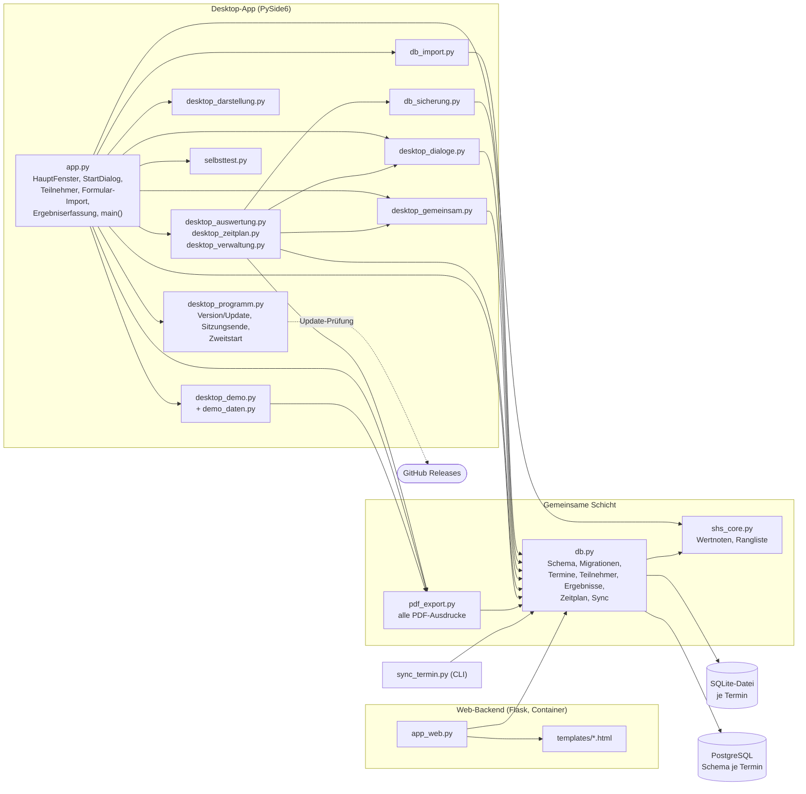

---

## 2. Klassen der Desktop-App

Die wichtigsten Klassen und wie sie zusammenhängen. Reiter sind `QWidget`s im
`HauptFenster`; Dialoge werden bei Bedarf modal geöffnet (`_ausfuehren`).

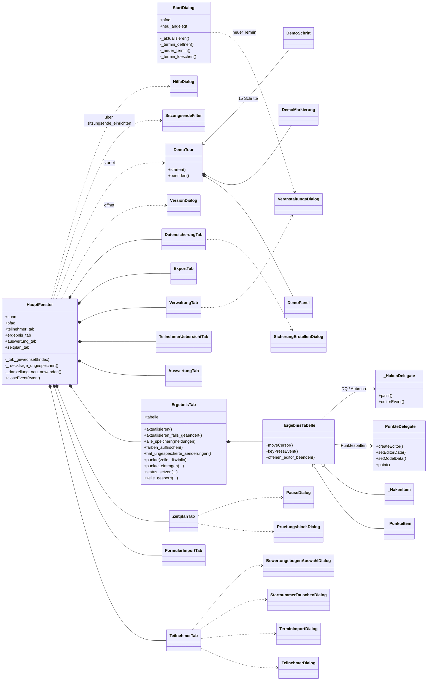

---

## 3. Gesamtablauf eines Prüfungstermins

Vom Anlegen bis zur Ergebnisliste. Gestrichelte Wege sind optional.

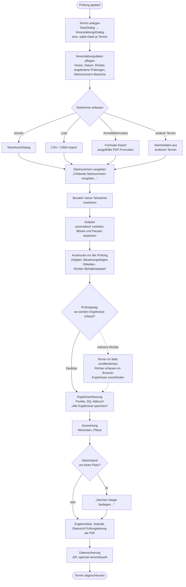

---

## 4. Programmstart und Beenden

`app.main()` bis zur Ereignisschleife und das Beenden des Hauptfensters.

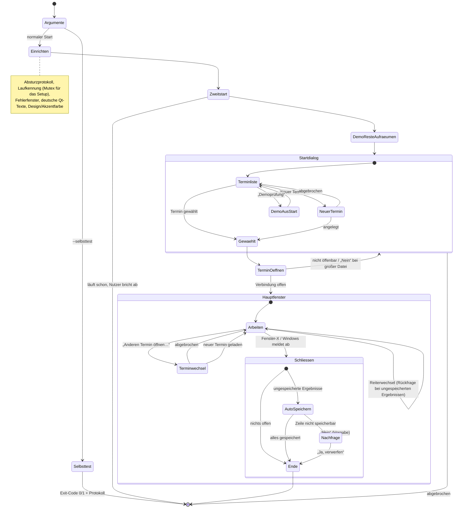

---

## 5. Termin öffnen (Prüfungen)

`_termin_oeffnen_mit_meldung` → `db.termin_oeffnen`. Fremde Dateien werden zuerst nur
lesend geprüft, bevor das Programm hineinschreibt.

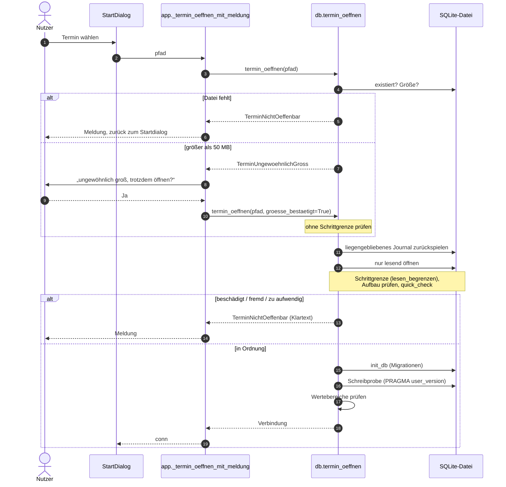

---

## 6. Teilnehmer erfassen und importieren

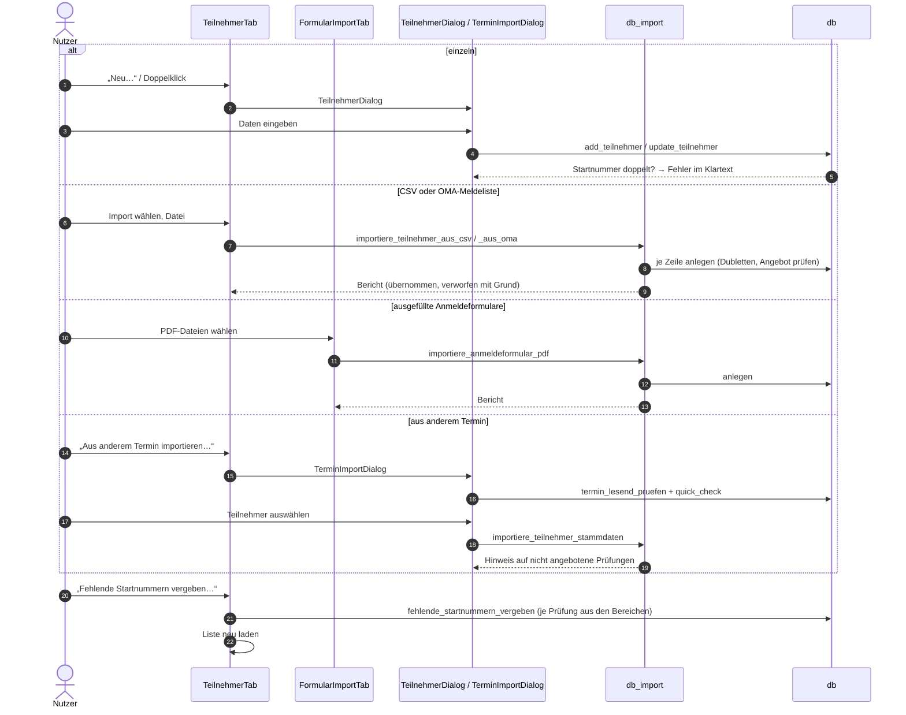

---

## 7. Zeitplan

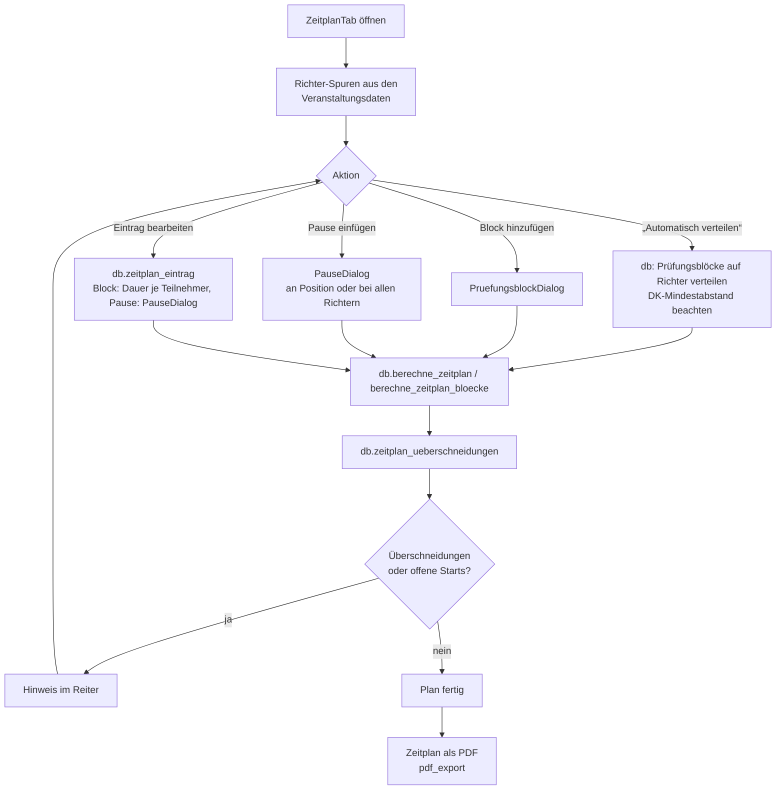

---

## 8. Ergebnisse erfassen und speichern (Desktop)

Seit O8 sind die Zellen `QTableWidgetItem`s; ein Eingabefeld entsteht nur beim Bearbeiten.
Gespeichert wird erst mit „Alle Ergebnisse speichern“ (oder Strg+S).

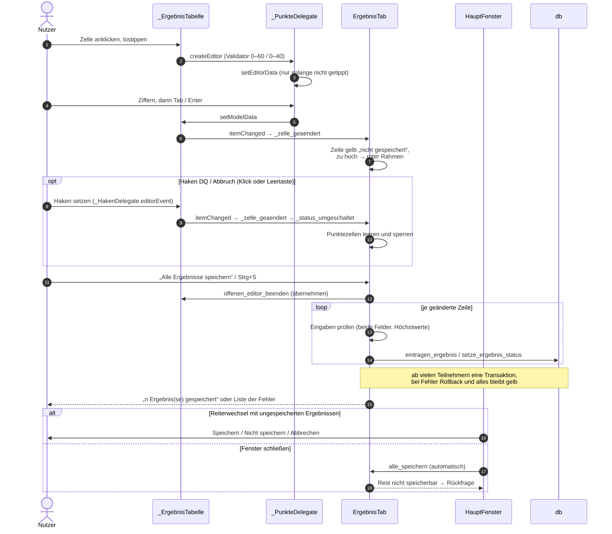

---

## 9. Auswertung, Stechen und Ausdrucke

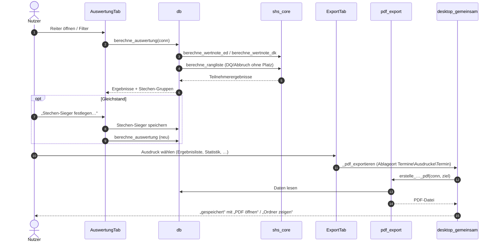

---

## 10. Web-Erfassung am Prüfungstag

Optional für größere Prüfungen: mehrere Richter erfassen gleichzeitig im Browser.
PostgreSQL hält je Termin ein eigenes Schema.

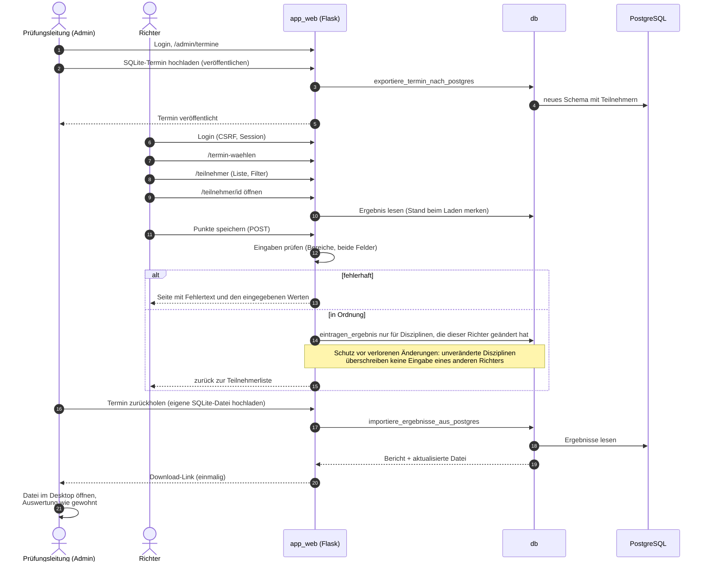

Ohne Browser geht dasselbe über `sync_termin.py` auf der Kommandozeile.

---

## 11. Datensicherung und Wiederherstellung

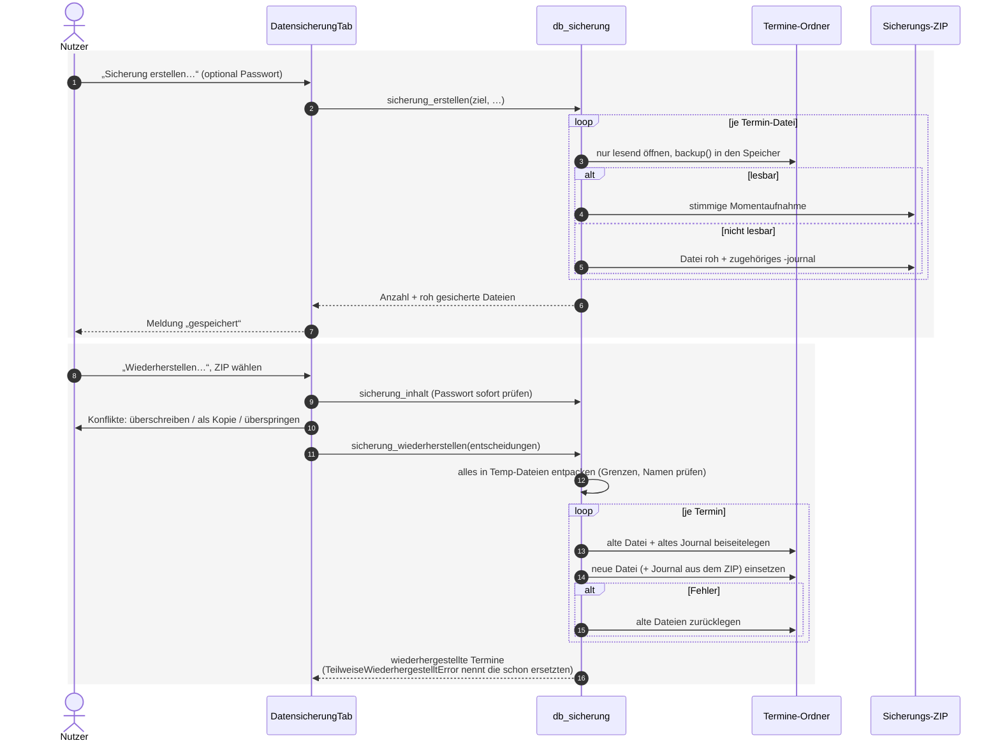

---

## 12. Update-Prüfung und Sitzungsende

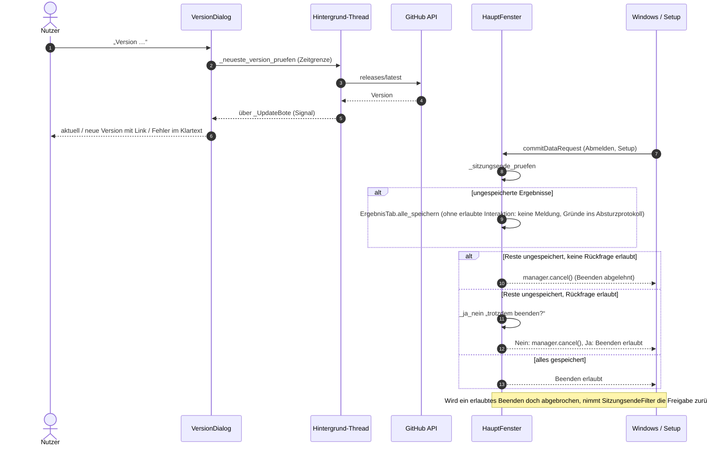

---

## 13. Demoprüfung

`DemoTour` spielt mit erfundenen Daten (`demo_daten.py`) einen Prüfungstag in einem eigenen
Temp-Ordner vor; der echte Termin bleibt unberührt.

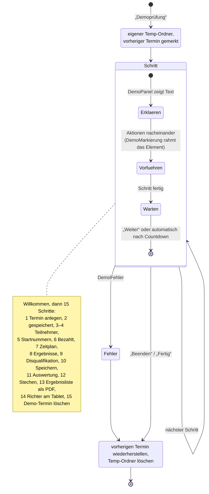
