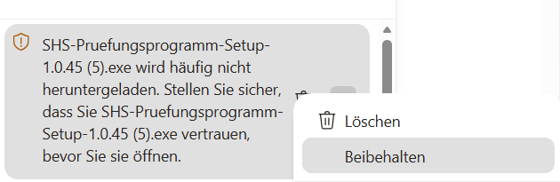

# SHS-Prüfungsprogramm installieren – in 5 Schritten

Für Windows 10 und 11. Du brauchst etwa fünf Minuten und eine Internetverbindung.
**Keine Sorge wegen der Warnungen:** Browser und Windows warnen bei neuen Programmen ohne
digitale Signatur immer. Das ist bei diesem Programm normal und kommt nur beim ersten Mal.
Kaputt machen kannst du dabei nichts.

## Schritt 1: Download-Seite öffnen

Im Browser die Adresse **github.com/mbruver-source/SHS/releases/latest** eingeben.
Nach unten scrollen bis zum Kasten **„Assets“** (das heißt: Dateien zum Herunterladen).

## Schritt 2: Die richtige Datei anklicken

Die Datei **SHS-Pruefungsprogramm-Setup-…exe** anklicken (statt „…“ steht dort die
Versionsnummer). Alle anderen Dateien (für Mac, Linux, „Source code“) brauchst du nicht.

## Schritt 3: Der Browser warnt – Datei behalten

Weil das Programm neu ist und selten heruntergeladen wird, hält der Browser es vorsorglich für
verdächtig.

- **Edge:** Oben rechts im Download-Fenster mit der Maus auf die Datei zeigen, auf **„…“**
  klicken und **„Beibehalten“** wählen. Fragt Edge noch einmal: **„Mehr anzeigen“** →
  **„Trotzdem beibehalten“**.

  

- **Chrome:** Die Tasten **Strg** und **J** gleichzeitig drücken. Bei der Datei auf
  **„Trotzdem behalten“** bzw. **„Gefährliche Datei behalten“** klicken und bestätigen.
- **Firefox:** blockiert die Datei normalerweise nicht. Falls doch: in der Download-Liste (Pfeil
  oben rechts) auf die Datei klicken → **„Download erlauben“**.

## Schritt 4: Windows warnt – trotzdem ausführen

Die heruntergeladene Datei öffnen (im Download-Fenster des Browsers anklicken). Erscheint ein
blaues Fenster **„Windows hat den Start dieser App verhindert“**:

1. auf den Text **„Weitere Informationen“** klicken,
2. dann auf den Knopf **„Trotzdem ausführen“**.

## Schritt 5: Installieren und starten

Das Installationsprogramm fragt zuerst, für wen installiert werden soll: **„Nur für mich“**
wählen – dann braucht es kein Administrator-Passwort. Danach die Lizenz mit **„Ich akzeptiere
die Vereinbarung“** bestätigen, immer **„Weiter“** klicken, dann **„Installieren“** und am Ende
**„Fertigstellen“**. Mit
dem Haken bei „jetzt starten“ öffnet sich das Programm gleich; später findest du es im
Startmenü unter **„SHS-Pruefungsprogramm“**.

**Tipp zum Kennenlernen:** Oben rechts auf **„Demoprüfung“** klicken – das Programm spielt einen
ganzen Prüfungstag mit erfundenen Daten vor.

**Neue Version?** Im Programm im Menü **„Hilfe → Nach Updates suchen…“**. Die neue Version
einfach genauso über die alte installieren – deine Termine bleiben erhalten.
