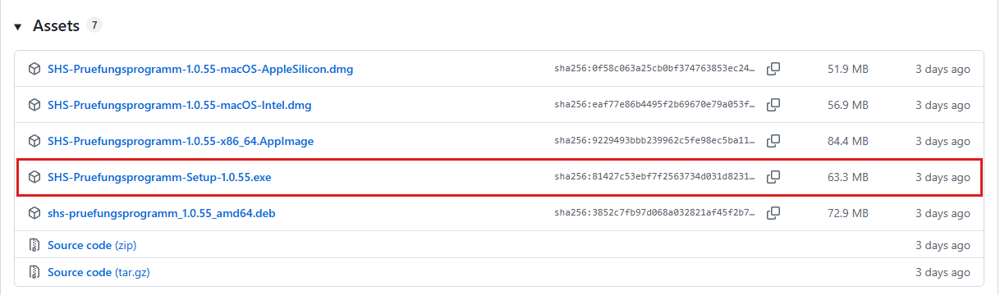
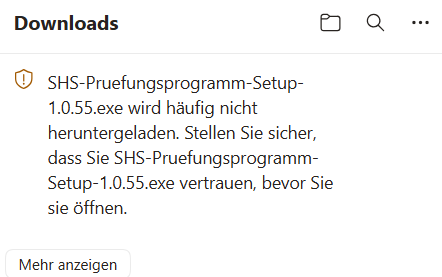
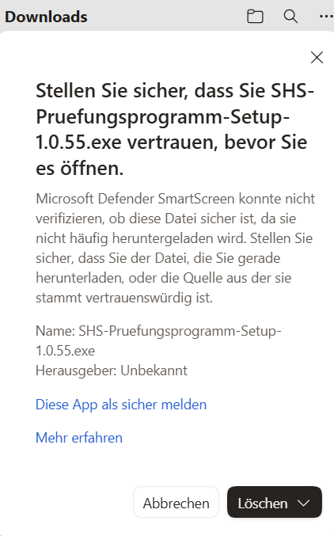
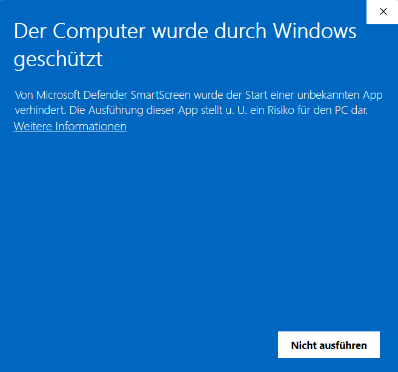
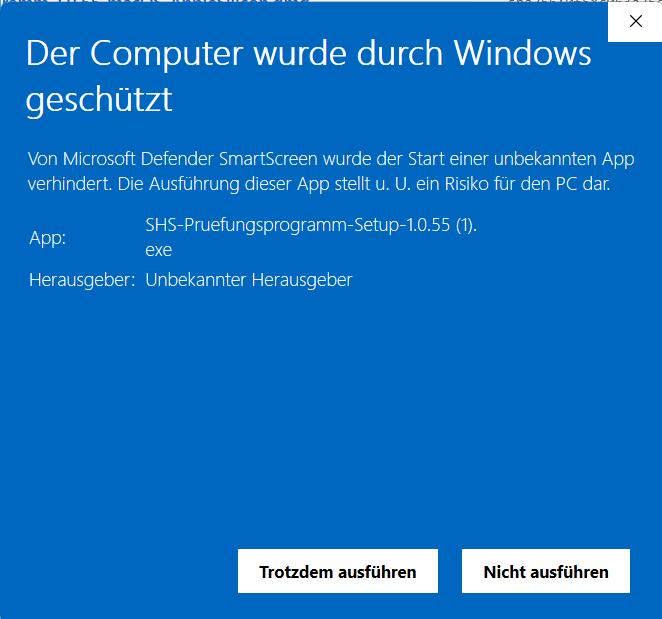
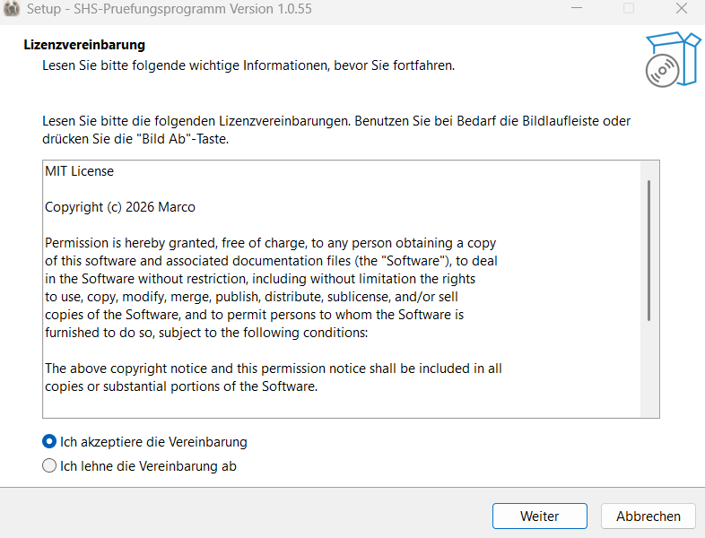
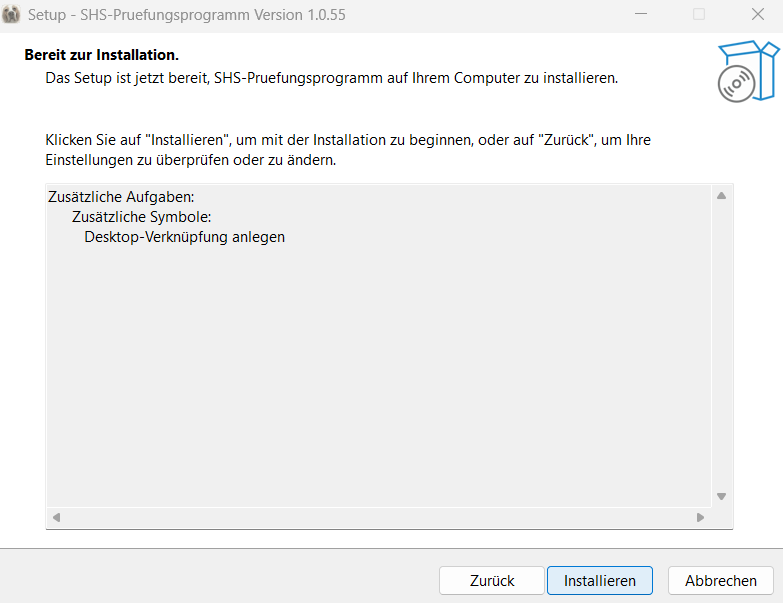
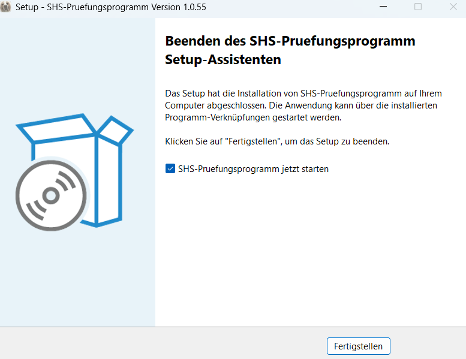

# SHS-Prüfungsprogramm installieren – in 5 Schritten

Für Windows 10 und 11. Du brauchst etwa fünf Minuten und eine Internetverbindung.
**Keine Sorge wegen der Warnungen:** Browser und Windows warnen bei neuen Programmen ohne
digitale Signatur immer. Das ist bei diesem Programm normal und kommt nur beim ersten Mal.
Kaputt machen kannst du dabei nichts.

## Schritt 1: Download-Seite öffnen

Am einfachsten über die Website des Programms, **mbruver-source.github.io/SHS**: Dort oben auf
den Knopf **„Aktuelle Version herunterladen“** klicken. Oder im Browser direkt die Adresse
**github.com/mbruver-source/SHS/releases/latest** eingeben.
Auf der Seite nach unten scrollen bis zum Kasten **„Assets“** (das heißt: Dateien zum
Herunterladen).

## Schritt 2: Die richtige Datei anklicken

Die Datei **SHS-Pruefungsprogramm-Setup-…exe** anklicken (statt „…“ steht dort die
Versionsnummer). Alle anderen Dateien (für Mac, Linux, „Source code“) brauchst du nicht.

## Schritt 3: Der Browser warnt – Datei behalten

Weil das Programm neu ist und selten heruntergeladen wird, hält der Browser es vorsorglich für
verdächtig.

- **Edge:** Oben rechts im Download-Fenster steht „… wird häufig nicht heruntergeladen“. Auf
  **„Mehr anzeigen“** klicken,

  

  dann im nächsten Fenster auf den **Pfeil neben „Löschen“** und **„Trotzdem beibehalten“**
  wählen (nicht auf „Löschen“ selbst).

  

- **Chrome:** Die Tasten **Strg** und **J** gleichzeitig drücken. Bei der Datei auf
  **„Trotzdem behalten“** bzw. **„Gefährliche Datei behalten“** klicken und bestätigen.
- **Firefox:** blockiert die Datei normalerweise nicht. Falls doch: in der Download-Liste (Pfeil
  oben rechts) auf die Datei klicken → **„Download erlauben“**.

## Schritt 4: Windows warnt – trotzdem ausführen

Die heruntergeladene Datei öffnen (im Download-Fenster des Browsers anklicken). Erscheint ein
blaues Fenster **„Der Computer wurde durch Windows geschützt“** (bei älteren Windows-Versionen
„Windows hat den Start dieser App verhindert“):

1. auf den unterstrichenen Text **„Weitere Informationen“** klicken,

   

2. dann auf den Knopf **„Trotzdem ausführen“** (nicht „Nicht ausführen“).

   

## Schritt 5: Installieren und starten

Beim ersten Mal fragt das Installationsprogramm zuerst, für wen installiert werden soll:
**„Nur für mich“** wählen – dann braucht es kein Administrator-Passwort (bei einem Update
kommt die Frage nicht).

1. Die Lizenz mit **„Ich akzeptiere die Vereinbarung“** bestätigen und **„Weiter“** klicken.

   

2. Den Haken bei **„Desktop-Verknüpfung anlegen“** lassen und **„Weiter“** klicken, dann
   **„Installieren“**.

   

3. Am Ende **„Fertigstellen“** klicken. Mit dem Haken bei „jetzt starten“ öffnet sich das
   Programm gleich; später findest du es auf dem Desktop und im Startmenü unter
   **„SHS-Pruefungsprogramm“**.

   

**Tipp zum Kennenlernen:** Oben rechts auf **„Demoprüfung“** klicken – das Programm spielt einen
ganzen Prüfungstag mit erfundenen Daten vor.

**Neue Version?** Im Programm im Menü **„Hilfe → Nach Updates suchen…“**. Die neue Version
einfach genauso über die alte installieren – deine Termine bleiben erhalten.
